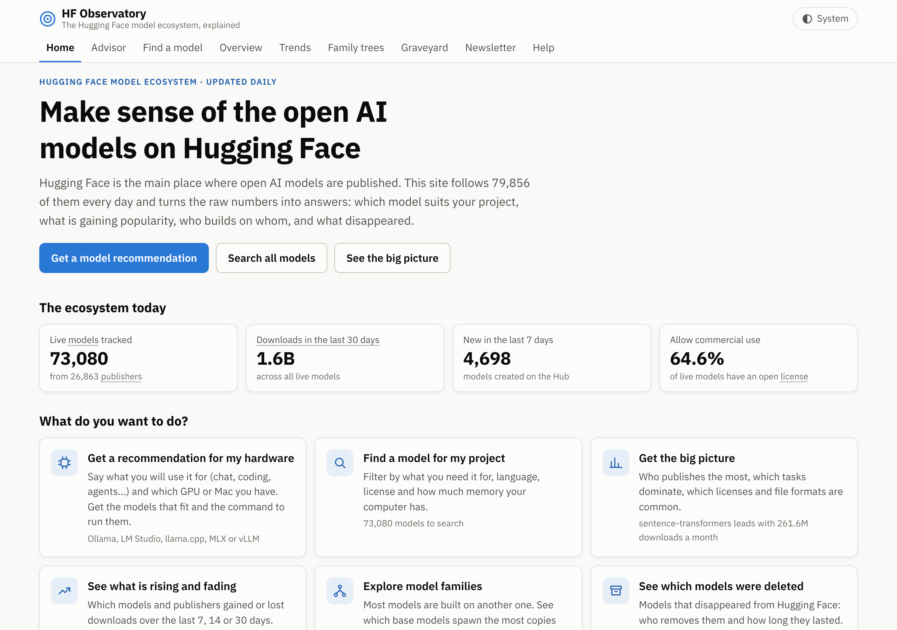
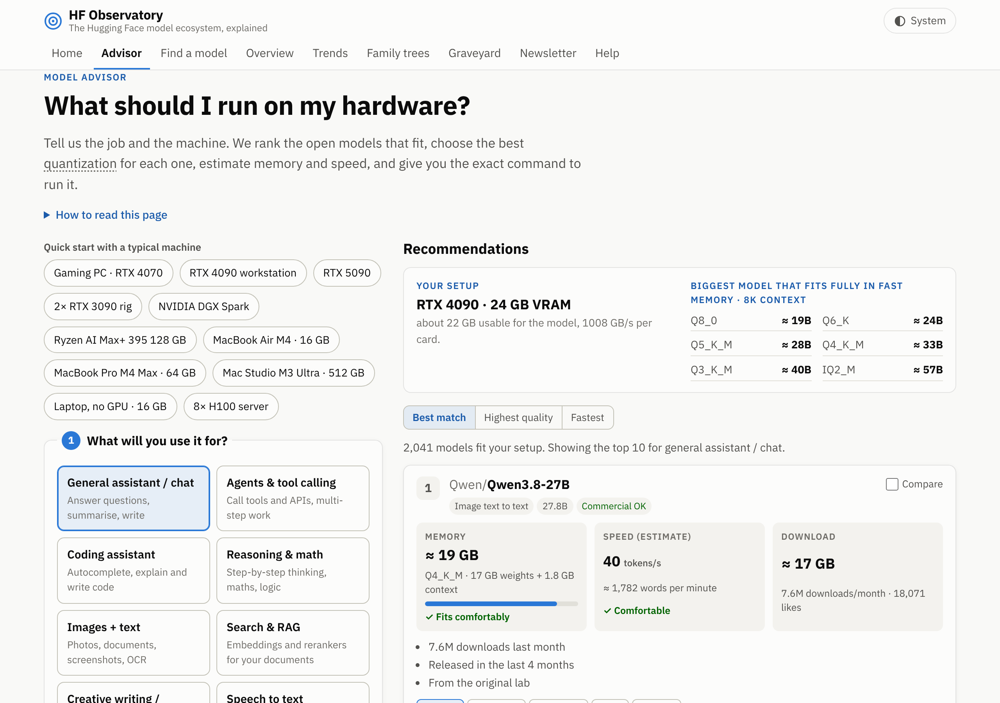

# HF Observatory

A public, static website to explore the Hugging Face model ecosystem: what gets published, by whom, under
which licenses, at what sizes, and which model fits your hardware and use case.

It is built entirely on the open dataset
**[radar-huggingface-dataset](https://github.com/686f6c61/radar-huggingface-dataset)** by
[HF//RADAR](https://radar-huggingface.686f6c61.dev), licensed
[CC-BY-4.0](https://creativecommons.org/licenses/by/4.0/). Model metadata originates from the
[Hugging Face Hub](https://huggingface.co). This project is not affiliated with Hugging Face or with the dataset author.

| Section | What it shows |
|---|---|
| **Home** | What the site is for in plain words, today's key numbers, “What do you want to do?” shortcuts to each section, this week's summary and the key terms. |
| **Model advisor** | “What should I run on my hardware?” Pick the job (chat, coding, reasoning, vision, RAG embeddings/rerankers, speech, image generation, writing) or the **kind of agent** (coding agent, browser/computer use, function calling, MCP assistant, research agent, data/SQL). Pick your hardware from one list: ~70 GPUs with VRAM and bandwidth (consumer, laptop, workstation, data centre, AMD, Intel) × number of cards, plus unified-memory machines in the same list (**NVIDIA DGX Spark**, 1 or 2 linked, DGX Station, Jetson Thor/Orin, AMD Ryzen AI Max+ 395), Apple Silicon by chip and memory, or CPU + RAM type, with optional RAM overflow. Then set runtime, KV-cache precision, context, concurrent users, a **dual-handle size range slider** and a quality ↔ speed slider. You get ranked models that fit, with the best quantization for your speed target, memory (weights + context), **estimated tokens/s** from memory bandwidth (MoE-aware), download size, why each was picked, agent frameworks and tool-call settings, ready-to-copy commands for Ollama, llama.cpp, LM Studio, MLX, vLLM and SGLang, a side-by-side comparison of up to 3 models, and a shareable link. Filter by **architecture (dense / mixture of experts)** and must-haves (tool calling, vision, thinking, long context, speculative decoding, pre-quantized build). Each result has a **Customize** panel to switch speculative decoding (DFlash2 / DFlash / DSpark / EAGLE-3 / MTP) and draft tokens, thinking on/off or reasoning effort, reasoning and tool parsers, context, users, KV cache, memory share, prefix cache, expert parallel, port, served name, API key, image tag, restart and health check; memory, speed and the Docker Compose file update live. **Saved composes**: press ☆ Save under any Docker Compose file to keep it (in your browser), rename it, edit the YAML with basic checks, add notes, reopen it in the advisor with the same machine, settings and Customize options, copy / download, and export or import them all as JSON. When nothing fits, the advisor tries relaxing each setting and offers one-click fixes with the number of models each brings back. |
| **Overview** | Totals (live, removed, gated, % open license), top publishers by model count and by 30-day downloads, tasks, licenses, sizes, formats, languages, families and models created per week. |
| **Model finder** | “Which model fits my needs?” Filter by text, task, language, commercial-use license, hardware budget (“fits in 16 GB”), format (GGUF, MLX, ONNX…), hide gated models; sort by downloads, likes, trending, newest or size. Each result has a short English model card and a link to the Hub. Filters are kept in the URL, so searches can be shared. |
| **Trends** | Download evolution across past releases (7/14/30-day windows): rising, fading, breakout and newcomer models with sparklines, publishers gaining or losing ground, adoption by family (Qwen, Llama, Mistral, Gemma…) as share of downloads or model count, and what is trending now. |
| **Family trees** | Which base models spawn the most derivatives (fine-tunes, quantizations, adapters, merges), derivatives by family, and a navigable radial graph + collapsible tree per base model. |
| **Graveyard** | Models removed from the Hub: who removes the most, how long they lived, removals per week, and how gated/unclear-license models compare with live ones. Searchable list of every removed model. |
| **Newsletter** | A weekly English summary generated automatically by comparing two releases a week apart: new models, removals, notable moves, busiest publishers. Monday-to-Monday issues are archived; a “Last 7 days” issue refreshes with every update. Available as Markdown and as an RSS feed (`data/newsletter/feed.xml` on the site). |






| Model finder | Mobile, dark theme |
|---|---|
|  |  |

| Trends | Newsletter |
|---|---|
|  |  |

| Family trees | Graveyard |
|---|---|
|  |  |

## How it works

```
radar-huggingface-dataset releases          pipeline/ (Python + DuckDB)              web/ (static site)
───────────────────────────────────         ───────────────────────────────          ──────────────────
latest/models.jsonl.gz  (~250 MB)  ──►  slim Parquet (cached) ──► small JSON  ──►  web/data/*.json
vN.0.0/models.jsonl.gz  (history)  ──►  one snapshot per day  ──► aggregates  ──►  HTML + ES modules
```

* **`pipeline/`** downloads the bulk file, streams it into DuckDB, drops the embedded Spanish model cards
  and writes small, pre-aggregated JSON files for each section. The ~250 MB bulk is never committed.
* **`web/`** is a dependency-free static site: plain HTML, CSS and ES modules, with hand-written SVG/CSS
  charts. No build step and no runtime CDN, so it works offline once loaded and is trivial to host on GitHub Pages.
* **`.github/workflows/`** rebuilds the data daily and deploys to GitHub Pages (see below).
* Every section opens with **key takeaways in plain English** and a “How to read this page” note, jargon is
  underlined with an on-hover/tap **glossary**, and the finder has one-click **quick-start presets**.
* **`tests/smoke.mjs`** opens every tab in headless Chromium (desktop light/dark and a 375 px phone) and fails
  on console errors, failed requests, sections that don’t render, or horizontal scrolling.

### Why this architecture

* **Pre-aggregation instead of DuckDB-WASM in the browser.** Loading the bulk file client-side would mean
  ~250 MB per visitor. The pipeline reduces it to ~15 KB for the overview and ~2 MB (gzipped) for the
  finder index, which is filtered in memory in a few milliseconds.
* **Column-oriented, dictionary-encoded finder index.** ~73k live models fit in one file without a backend.
* **Data is built in CI and deployed as a Pages artifact, not committed.** The repository stays small and the
  history stays readable.

## How the automatic update works

`.github/workflows/deploy.yml` runs **every day at 07:23 UTC** (after the radar's 06:00 Madrid export is
released), on every push to `main`, and on demand (*Actions → Build data and deploy site → Run workflow*):

1. Runs the pipeline unit tests.
2. Restores the cache of slim historical snapshots (`pipeline/.cache/snapshots`, ~2 MB per release).
3. Runs `python pipeline/build.py`. It downloads the floating `latest` bulk plus any numbered release
   it has not cached yet (normally just the newest one), then writes `web/data/` (~9 MB in total). Weekly
   newsletter issues are regenerated deterministically from the immutable releases, so the archive
   needs no storage of its own.
4. Saves the snapshot cache for the next run.
5. Runs the headless smoke test against the freshly built site. A broken build never gets deployed.
6. Uploads `web/` as a Pages artifact and deploys it with `actions/deploy-pages`.

Nothing generated is committed, so the repository history stays free of data churn. The first run (or a
run after the cache expires, which happens after 7 days without runs) downloads ~45 releases and takes
around 15–20 minutes. Later runs take a couple of minutes.

`.github/workflows/ci.yml` runs on pull requests: unit tests, a build with a short history, and the smoke test.

**One-time setup:** in the repository settings, set *Pages → Build and deployment → Source* to
**GitHub Actions**. If you deploy the site somewhere other than `https://<owner>.github.io/hf-observatory/`,
set the `SITE_URL` environment variable in the workflow so that links in the RSS feed point to the right place.

## Run locally

Requirements: Python 3.10+, Node 18+ (only for the headless test).

```bash
pip install -r pipeline/requirements.txt

# Quick: only the latest bulk (~250 MB). Trends and Newsletter will show "not enough history".
python pipeline/build.py --no-history

# Full: also the past releases used by Trends and the Newsletter (one ~250 MB download per release
# the first time, ~40 releases by default; each is reduced to a ~2 MB Parquet file and cached)
python pipeline/build.py

# Serve the site
python -m http.server 8000 --directory web    # → http://localhost:8000
```

Useful flags: `--latest-gz path/to/models.jsonl.gz` reuses a file you already downloaded;
`--cache DIR` changes where downloads and snapshots are kept (default `pipeline/.cache`);
`--history-days N` / `--max-snapshots N` control how much history is used (daily snapshots for the last
N days, Mondays only before that).

Tests:

```bash
python -m pytest pipeline/tests          # pipeline unit tests (tiny fixture, no network)
npm test                                  # advisor engine unit tests + combinatorial fuzz over the real data
node tests/advisor-ui.mjs                 # randomised clicks through the Advisor in headless Chromium
node tests/compose-validate.mjs           # generated compose files through `docker compose config`
npm install && npx playwright install chromium
npm run test:e2e                          # headless check of every tab
npm run screenshots                       # refresh docs/screenshots/
```

## Data notes

* `downloads_30d` is a rolling 30-day window published by the Hub.
* License classes come from the dataset: **open** (commercial use allowed), **non-commercial**, or
  **unclear** (missing, “other”, or ambiguous). Always check the model card before using a model commercially.
* Memory estimates in the finder are rough: parameters × bytes per parameter (2 for 16-bit, ~1.1 for 8-bit,
  ~0.6 for 4-bit and GGUF, assuming the common Q4 quantization) + 15%. Models without a parameter count have no
  estimate and are excluded by size filters unless you include them explicitly.
* The dataset’s model cards and schema are written in Spanish. The site does not reproduce the cards; the
  short English descriptions are generated from structured metadata, and the schema is translated on the
  site’s *About the data* page.
* The radar started in August 2026, so anything earlier is reconstructed from creation dates.
* Family trees use the Hub tags `base_model:<relation>:<parent>`; models that only declare `base_model` count as
  “other derivatives”. Parents are matched case-insensitively and only live models are counted as derivatives.
  Very large families are trimmed in the tree (top 120 children of the base, top 25 below that, 4 generations).
* Advisor GPU-server formats follow the architecture: Blackwell (RTX 50, RTX PRO 6000 Blackwell, B200, DGX Spark,
  Jetson Thor) → BF16 / FP8 / **NVFP4**; Hopper, Ada and AMD CDNA3 → BF16 / FP8 / AWQ-GPTQ; Ampere, Turing and others →
  BF16 / INT8 / AWQ-GPTQ; gpt-oss always runs its native MXFP4. The card links the exact repository to download (the
  NVFP4 / FP8 / AWQ / GGUF / MLX build), with the original model as the title. FP8 falls back to on-the-fly
  quantization (`--quantization fp8`) when no FP8 build is tracked.
* Speculative decoding: drafts are found from their tags and base model (DFlash2, DFlash, DSpark, EAGLE-3), and MTP
  from the model's own tags/architecture or an MTP-preserving GGUF. vLLM gets `--speculative-config` (`dflash`, `eagle3`
  or the family's MTP method), SGLang `--speculative-algorithm DFLASH | DSPARK | EAGLE3 | NEXTN`, llama.cpp
  `--spec-type draft-mtp` or a DFlash2 GGUF draft (`-hfd`, needs a build with DFlash2). Speed-ups (1.5–2.3× for one
  user, less when serving many) are estimates; acceptance rates vary by prompt.
* vLLM, SGLang, Ollama, llama.cpp and Text Embeddings Inference commands are also given as Docker Compose files
  (NVIDIA GPU reservation, ROCm images and `/dev/kfd` for AMD, a note for ARM64 machines such as DGX Spark).
* **Model architecture from `config.json`.** The pipeline reads each advisor model's `config.json` from the Hub
  (cached in `pipeline/.cache/snapshots/configs.json`, failures retried weekly; set `HF_TOKEN` to include gated
  models, `HFO_OFFLINE=1` to skip). From it come the exact KV-cache bytes per token (layers × KV heads × head size,
  MLA latents, sliding-window and linear-attention layers), the longest context the model supports (the advisor
  never sizes or launches a model beyond it) and the active size of mixture-of-experts models whose name does
  not say it. Models without a readable config use the estimate below.
* **Speed is calibrated** on published llama.cpp results (Apple Silicon M1–M4, DGX Spark):
  `tests/advisor-calibration.test.mjs` fails if generation drifts more than 25% or prompt reading more than 50%
  from them. Prompt reading (time to first token) uses each GPU's dense FP16 tensor TFLOPS.
* **Mixture-of-experts models larger than the GPU** can keep their expert weights in system RAM with llama.cpp
  (`--n-cpu-moe N`, or `--cpu-moe`) while attention, shared weights and the context stay on the GPU; the advisor
  compares that with splitting whole layers (what Ollama does) and recommends the faster one, with the flag.
* **Several users**: one pass over the weights serves every user in the batch, but each user's cache is read and
  a MoE touches more experts as the batch grows; past that, the GPU's compute caps the total. Cards show the speed
  per user and the total.
* **Two kinds of card** (e.g. RTX 4090 + RTX 3090): llama.cpp / Ollama use all the memory and the layers take turns
  at each card's bandwidth; vLLM / SGLang tensor parallel counts every card as the smaller and slower one.
* **Full stack compose**: every LLM card has a tab with one compose file holding the model server, Open WebUI
  already connected to it, and an embedding model plus a reranker (Text Embeddings Inference) picked by the
  advisor's RAG ranking for the same machine. TEI uses its CUDA build for the GPU generation when one exists and
  the CPU build otherwise or next to vLLM / SGLang (which reserve the GPU memory); host ports never collide.
* **Sharing a saved compose** puts it, compressed, in the link itself (`#advisor?…&fav=…`): no server stores it,
  and whoever opens the link sees it and can save it to their own list.
* Every generated compose file is checked in CI with Docker's own parser (`tests/compose-validate.mjs` runs
  `docker compose config` on 600 of them across machines, runtimes and Customize settings).
* Without config data, the advisor's memory estimate is parameters × bytes per parameter for the quantization + a KV cache of
  ~1 GB per 8K tokens for an 8B model (growing sub-linearly with size; for mixture-of-experts models with the
  geometric mean of active and total parameters, and scaled by the attention type read from the Hub
  architecture tag: ×0.3 for MLA such as DeepSeek-V3 / Kimi K2 / GLM-5, ×0.25 for hybrid linear-attention
  models such as Qwen3.5 / Qwen3-Next and for Gemma's sliding-window layers, ×0.5 for gpt-oss) + 0.5 GB.
  Speed reads the active weights plus about a third of the context's cache per token. With 3 or 6 GPUs, vLLM and
  SGLang get tensor parallel × pipeline parallel (e.g. TP 2 × PP 3); two linked DGX Spark get a multi-node setup
  (Ray for vLLM, `--nnodes` for SGLang), and Ollama / llama.cpp count only one unit. Usable memory is the VRAM minus
  ~0.8 GB, or about 67–75% of a Mac's unified memory. GGUF/MLX builds are only linked when their repository name
  is the original name plus quantization markers, so fine-tunes are never offered as “the GGUF of” a model.
* Removal dates are when the radar *detected* the 404, not when the author deleted the model.
* Trends compare the first export of each day (`vN.0.0`). Rankings only include models present in both
  snapshots, so the radar adding models over time is not mistaken for growth. Releases v29–v34 were rebuilt by
  the dataset author after a worker outage (Sep 17–22, 2026); their dates are taken from the version number.

## License and attribution

Data: [radar-huggingface-dataset](https://github.com/686f6c61/radar-huggingface-dataset) by
HF//RADAR, [CC-BY-4.0](https://creativecommons.org/licenses/by/4.0/). The site credits the dataset in its
footer and on the *About the data* page.
