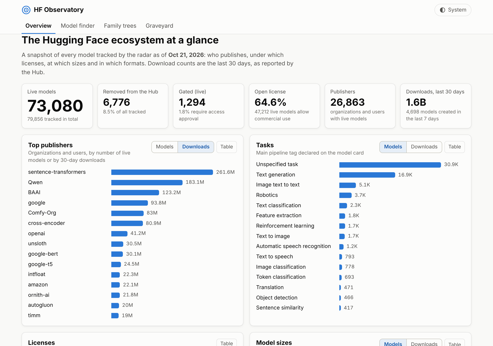
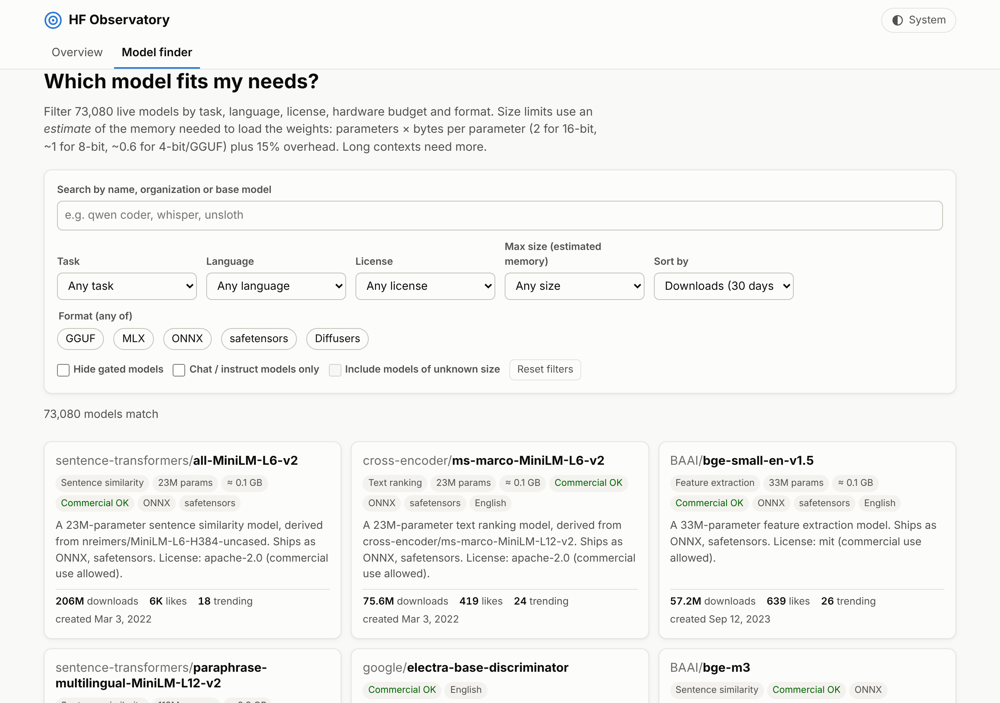
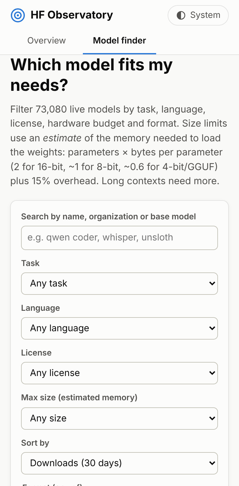
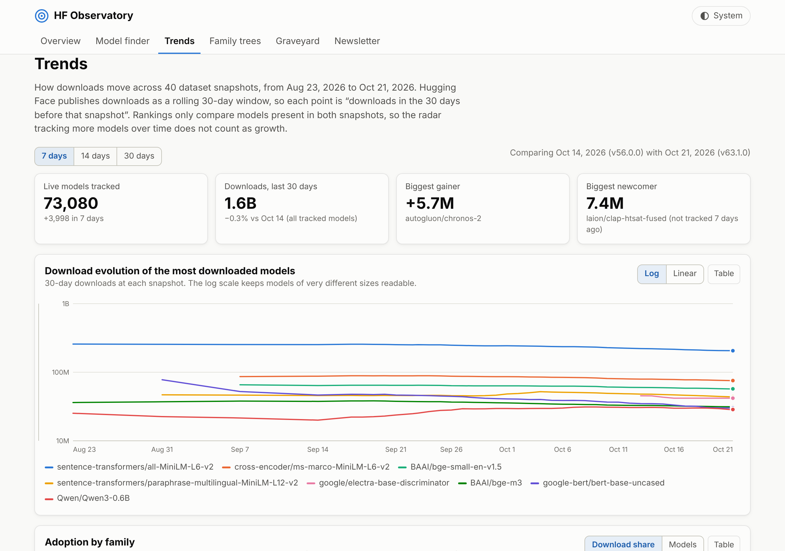
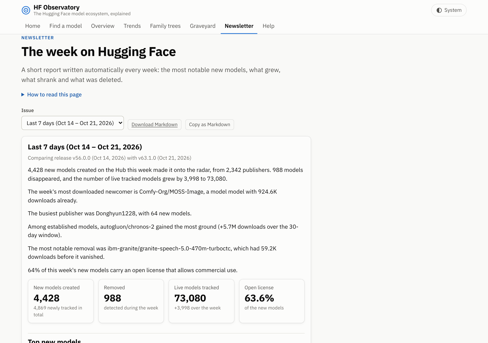
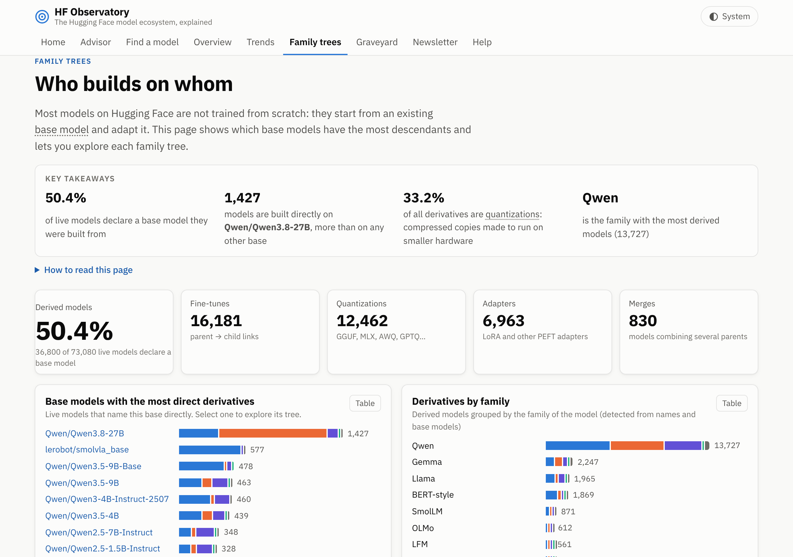
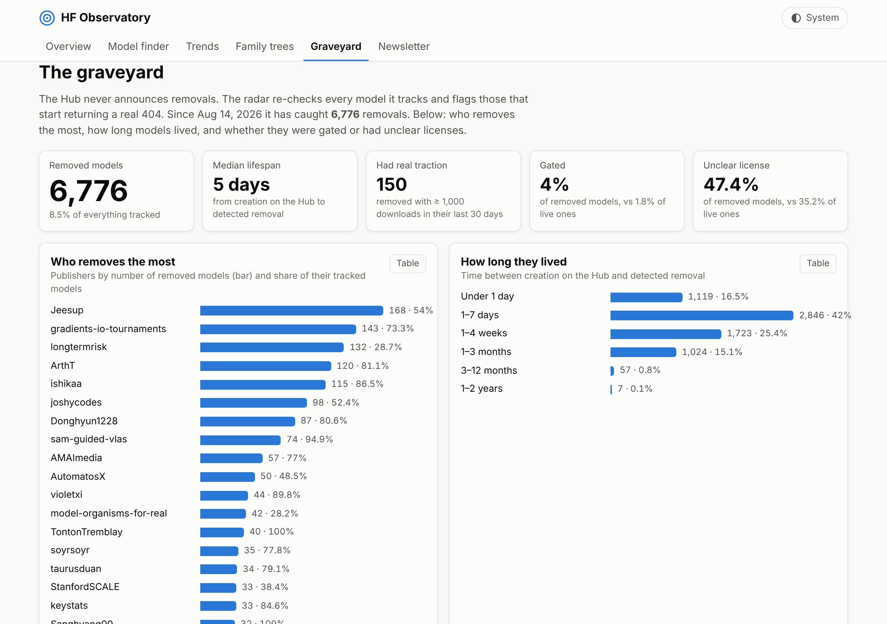

# HF Observatory

A public, static website to explore the Hugging Face model ecosystem: what gets published, by whom, under
which licenses, at what sizes, and which model fits your hardware and use case.

It is built entirely on the open dataset
**[radar-huggingface-dataset](https://github.com/686f6c61/radar-huggingface-dataset)** by
[HF//RADAR](https://radar-huggingface.686f6c61.dev), licensed
[CC-BY-4.0](https://creativecommons.org/licenses/by/4.0/). Model metadata originates from the
[Hugging Face Hub](https://huggingface.co). This project is not affiliated with Hugging Face or with the dataset author.

| Section | What it shows |
|---|---|
| **Overview** | Totals (live, removed, gated, % open license), top publishers by model count and by 30-day downloads, tasks, licenses, sizes, formats, languages, families and models created per week. |
| **Model finder** | “Which model fits my needs?” Filter by text, task, language, commercial-use license, hardware budget (“fits in 16 GB”), format (GGUF, MLX, ONNX…), hide gated models; sort by downloads, likes, trending, newest or size. Each result has a short English model card and a link to the Hub. Filters are kept in the URL, so searches can be shared. |
| **Trends** | Download evolution across past releases (7/14/30-day windows): rising, fading, breakout and newcomer models with sparklines, publishers gaining or losing ground, adoption by family (Qwen, Llama, Mistral, Gemma…) as share of downloads or model count, and what is trending now. |
| **Family trees** | Which base models spawn the most derivatives (fine-tunes, quantizations, adapters, merges), derivatives by family, and a navigable radial graph + collapsible tree per base model. |
| **Graveyard** | Models removed from the Hub: who removes the most, how long they lived, removals per week, and how gated/unclear-license models compare with live ones. Searchable list of every removed model. |
| **Newsletter** | A weekly English summary generated automatically by comparing two releases a week apart: new models, removals, notable moves, busiest publishers. Monday-to-Monday issues are archived; a “Last 7 days” issue refreshes with every update. Available as Markdown and as an RSS feed (`data/newsletter/feed.xml` on the site). |



| Model finder | Mobile, dark theme |
|---|---|
|  |  |

| Trends | Newsletter |
|---|---|
|  |  |

| Family trees | Graveyard |
|---|---|
|  |  |

## How it works

```
radar-huggingface-dataset releases          pipeline/ (Python + DuckDB)              web/ (static site)
───────────────────────────────────         ───────────────────────────────          ──────────────────
latest/models.jsonl.gz  (~250 MB)  ──►  slim Parquet (cached) ──► small JSON  ──►  web/data/*.json
vN.0.0/models.jsonl.gz  (history)  ──►  one snapshot per day  ──► aggregates  ──►  HTML + ES modules
```

* **`pipeline/`** downloads the bulk file, streams it into DuckDB, drops the embedded Spanish model cards
  and writes small, pre-aggregated JSON files for each section. The ~250 MB bulk is never committed.
* **`web/`** is a dependency-free static site: plain HTML, CSS and ES modules, with hand-written SVG/CSS
  charts. No build step and no runtime CDN, so it works offline once loaded and is trivial to host on GitHub Pages.
* **`.github/workflows/`** rebuilds the data daily and deploys to GitHub Pages (see below).
* **`tests/smoke.mjs`** opens every tab in headless Chromium (desktop light/dark and a 375 px phone) and fails
  on console errors, failed requests, sections that don’t render, or horizontal scrolling.

### Why this architecture

* **Pre-aggregation instead of DuckDB-WASM in the browser.** Loading the bulk file client-side would mean
  ~250 MB per visitor. The pipeline reduces it to ~15 KB for the overview and ~2 MB (gzipped) for the
  finder index, which is filtered in memory in a few milliseconds.
* **Column-oriented, dictionary-encoded finder index.** ~73k live models fit in one file without a backend.
* **Data is built in CI and deployed as a Pages artifact, not committed.** The repository stays small and the
  history stays readable.

## How the automatic update works

`.github/workflows/deploy.yml` runs **every day at 07:23 UTC** (after the radar's 06:00 Madrid export is
released), on every push to `main`, and on demand (*Actions → Build data and deploy site → Run workflow*):

1. Runs the pipeline unit tests.
2. Restores the cache of slim historical snapshots (`pipeline/.cache/snapshots`, ~2 MB per release).
3. Runs `python pipeline/build.py`. It downloads the floating `latest` bulk plus any numbered release
   it has not cached yet (normally just the newest one), then writes `web/data/` (~9 MB in total). Weekly
   newsletter issues are regenerated deterministically from the immutable releases, so the archive
   needs no storage of its own.
4. Saves the snapshot cache for the next run.
5. Runs the headless smoke test against the freshly built site. A broken build never gets deployed.
6. Uploads `web/` as a Pages artifact and deploys it with `actions/deploy-pages`.

Nothing generated is committed, so the repository history stays free of data churn. The first run (or a
run after the cache expires, which happens after 7 days without runs) downloads ~45 releases and takes
around 15–20 minutes. Later runs take a couple of minutes.

`.github/workflows/ci.yml` runs on pull requests: unit tests, a build with a short history, and the smoke test.

**One-time setup:** in the repository settings, set *Pages → Build and deployment → Source* to
**GitHub Actions**. If you deploy the site somewhere other than `https://<owner>.github.io/hf-observatory/`,
set the `SITE_URL` environment variable in the workflow so that links in the RSS feed point to the right place.

## Run locally

Requirements: Python 3.10+, Node 18+ (only for the headless test).

```bash
pip install -r pipeline/requirements.txt

# Quick: only the latest bulk (~250 MB). Trends and Newsletter will show "not enough history".
python pipeline/build.py --no-history

# Full: also the past releases used by Trends and the Newsletter (one ~250 MB download per release
# the first time, ~40 releases by default; each is reduced to a ~2 MB Parquet file and cached)
python pipeline/build.py

# Serve the site
python -m http.server 8000 --directory web    # → http://localhost:8000
```

Useful flags: `--latest-gz path/to/models.jsonl.gz` reuses a file you already downloaded;
`--cache DIR` changes where downloads and snapshots are kept (default `pipeline/.cache`);
`--history-days N` / `--max-snapshots N` control how much history is used (daily snapshots for the last
N days, Mondays only before that).

Tests:

```bash
python -m pytest pipeline/tests          # pipeline unit tests (tiny fixture, no network)
npm install && npx playwright install chromium
npm run test:e2e                          # headless check of every tab
npm run screenshots                       # refresh docs/screenshots/
```

## Data notes

* `downloads_30d` is a rolling 30-day window published by the Hub.
* License classes come from the dataset: **open** (commercial use allowed), **non-commercial**, or
  **unclear** (missing, “other”, or ambiguous). Always check the model card before using a model commercially.
* Memory estimates in the finder are rough: parameters × bytes per parameter (2 for 16-bit, ~1.1 for 8-bit,
  ~0.6 for 4-bit and GGUF, assuming the common Q4 quantization) + 15%. Models without a parameter count have no
  estimate and are excluded by size filters unless you include them explicitly.
* The dataset’s model cards and schema are written in Spanish. The site does not reproduce the cards; the
  short English descriptions are generated from structured metadata, and the schema is translated on the
  site’s *About the data* page.
* The radar started in August 2026, so anything earlier is reconstructed from creation dates.
* Family trees use the Hub tags `base_model:<relation>:<parent>`; models that only declare `base_model` count as
  “other derivatives”. Parents are matched case-insensitively and only live models are counted as derivatives.
  Very large families are trimmed in the tree (top 120 children of the base, top 25 below that, 4 generations).
* Removal dates are when the radar *detected* the 404, not when the author deleted the model.
* Trends compare the first export of each day (`vN.0.0`). Rankings only include models present in both
  snapshots, so the radar adding models over time is not mistaken for growth. Releases v29–v34 were rebuilt by
  the dataset author after a worker outage (Sep 17–22, 2026); their dates are taken from the version number.

## License and attribution

Data: [radar-huggingface-dataset](https://github.com/686f6c61/radar-huggingface-dataset) by
HF//RADAR, [CC-BY-4.0](https://creativecommons.org/licenses/by/4.0/). The site credits the dataset in its
footer and on the *About the data* page.
